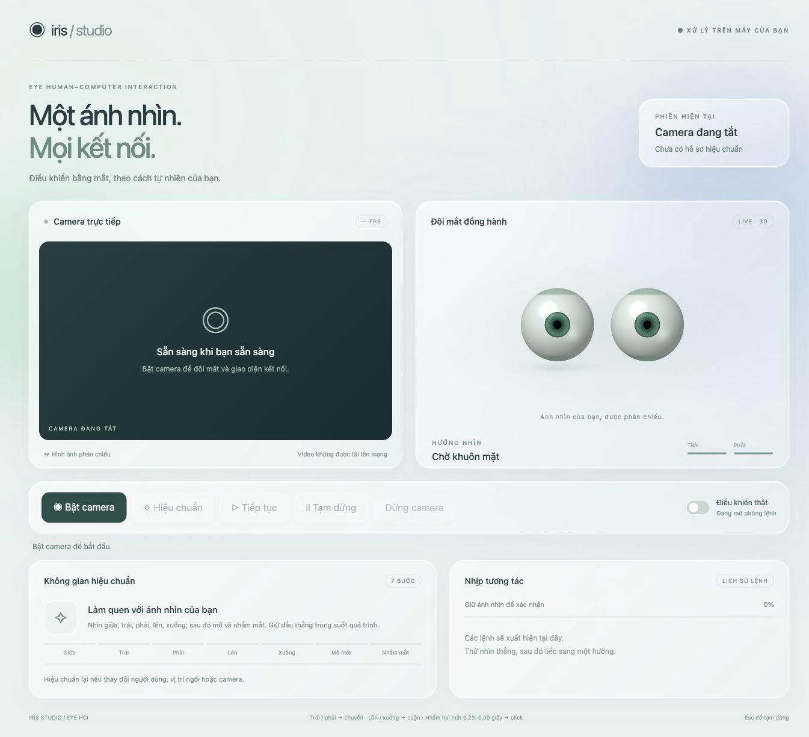
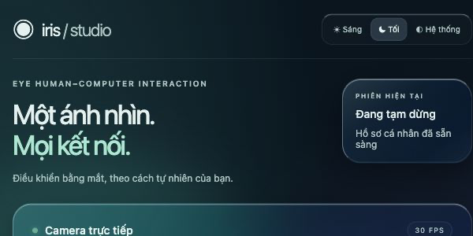
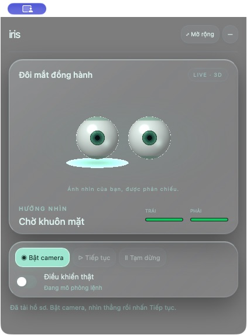

# Eye HCI · Iris Studio

**Điều khiển bằng ánh mắt qua webcam.** Liếc trái hoặc phải để gửi phím mũi tên, liếc lên hoặc xuống để cuộn, và nhắm cả hai mắt có chủ đích để bấm tại vị trí con trỏ hiện tại.

Iris Studio hiển thị hướng nhìn và độ mở mắt qua một đôi mắt 3D. Bạn có thể thử cử chỉ ở chế độ mô phỏng trước khi bật điều khiển ứng dụng. Camera và nhận diện được xử lý trên máy, không cần dịch vụ đám mây khi chạy.



*Bảng điều khiển khi camera chưa bật.*

## Cài đặt và chạy

Chuẩn bị **Git, Python 3.11** (phiên bản đã dùng để kiểm thử) và một webcam. Bản desktop trên macOS cần thêm **Xcode Command Line Tools** để biên dịch cửa sổ native ở lần chạy đầu.

```bash
git clone https://github.com/zzzthanhvdatzzz/eye-hci.git
cd eye-hci
python3.11 -m venv .venv
source .venv/bin/activate
python -m pip install -r requirements.txt
```

Model MediaPipe đã có sẵn trong thư mục [models](models/). Chọn cách mở phù hợp:

| Cách mở | Lệnh | Khi nào dùng |
| --- | --- | --- |
| Trình duyệt | `python step6_hci.py` | Chạy thử nhanh. Trình duyệt tự mở [bảng điều khiển trên máy](http://127.0.0.1:8765/). |
| Desktop trên macOS | `python step6_hci.py --desktop` | Dùng cửa sổ nổi thu gọn và hiệu ứng kính mờ phía sau cửa sổ. |

Sau khi cài đặt, trên macOS bạn cũng có thể nhấp đúp [Iris Studio.command](Iris%20Studio.command) trong Finder để mở bản desktop.

## Thử cử chỉ đầu tiên

1. Nhấn **Bật camera** và ngồi sao cho webcam thấy rõ cả hai mắt.
2. Nhấn **Hiệu chuẩn** và làm theo bảy bước trên màn hình: nhìn giữa, trái, phải, lên, xuống, mở mắt rồi nhắm cả hai mắt. Giữ đầu thẳng và di chuyển mắt theo hướng được yêu cầu.
3. Nhấn **Tiếp tục**. Nhìn thẳng với mắt mở, sau đó liếc phải khoảng nửa giây. Bạn sẽ thấy lệnh **NEXT** xuất hiện trong **Nhịp tương tác**.
4. Khi đã quen, bật **Điều khiển thật**, nhấn **Tiếp tục** lần nữa rồi chuyển sang ứng dụng bạn muốn điều khiển. Trên macOS, cấp quyền **Accessibility** cho ứng dụng chạy Python để gửi phím, cuộn và bấm chuột.

Hồ sơ hiệu chuẩn được lưu trên máy tại `profiles/default.json` và tự tải ở lần chạy sau. Hãy hiệu chuẩn lại khi đổi người dùng hoặc thay đổi đáng kể vị trí camera hay tư thế ngồi.

| Cử chỉ | Kết quả khi bật điều khiển thật |
| --- | --- |
| Giữ liếc phải ít nhất 0,40 giây | Gửi phím mũi tên phải |
| Giữ liếc trái ít nhất 0,40 giây | Gửi phím mũi tên trái |
| Giữ liếc lên hoặc xuống ít nhất 0,40 giây | Cuộn lên hoặc xuống |
| Nhắm cả hai mắt trong 0,23–0,50 giây rồi mở | Bấm tại vị trí con trỏ hiện tại |

Nhìn về giữa sau mỗi lệnh hướng để chuẩn bị cho lần tiếp theo. Để ngừng phát lệnh, nhấn **Tạm dừng** hoặc **Esc** khi giao diện đang được chọn. **Dừng camera** giải phóng webcam. Dùng **Ctrl+C** trong Terminal để thoát máy chủ.

## Giao diện và cửa sổ nổi

Bộ chọn **Sáng / Tối / Hệ thống** nằm ở góc trên bên phải. Trên bản desktop macOS, **Hệ thống** dùng hiệu ứng kính của macOS để làm mờ nội dung nằm ngay sau cửa sổ. Trong trình duyệt, chế độ này dùng ảnh nền mờ dự phòng khi lấy được hình nền desktop.

| Chế độ tối | Cửa sổ thu gọn trên macOS |
| --- | --- |
|  |  |

Trong bản desktop, nhấn **Thu gọn** để giữ cửa sổ nhỏ nổi trên các ứng dụng khác và kéo bằng thanh tiêu đề. Nhấn **Mở rộng** để quay lại giao diện đầy đủ, chẳng hạn khi cần hiệu chuẩn. Nút **—** đưa cửa sổ xuống Dock. Nếu muốn ngừng điều khiển, nhấn **Tạm dừng** trước khi thu cửa sổ.

## Xử lý lỗi thường gặp

| Hiện tượng | Cách kiểm tra |
| --- | --- |
| Webcam không mở | Cấp quyền **Camera** cho Terminal hoặc ứng dụng chạy Python. Nếu máy có nhiều camera, thử `python step6_hci.py --camera 1`. |
| Có lệnh trong **Nhịp tương tác** nhưng ứng dụng không phản hồi | Bật **Điều khiển thật**, nhấn **Tiếp tục**, kiểm tra quyền **Accessibility** trên macOS rồi chọn đúng cửa sổ cần điều khiển. |
| Không thấy kính mờ xuyên qua cửa sổ phía sau | Mở bản desktop trên macOS và chọn **Hệ thống**. Tùy chọn **Reduce Transparency** của macOS có thể làm giảm hiệu ứng. |
| Cổng 8765 đang được dùng | Thử `python step6_hci.py --port 8766` và mở [bảng điều khiển ở cổng 8766](http://127.0.0.1:8766/). |

Nếu thiếu `models/face_landmarker.task`, chạy từ thư mục dự án:

```bash
mkdir -p models
curl -fL -o models/face_landmarker.task https://storage.googleapis.com/mediapipe-models/face_landmarker/face_landmarker/float16/1/face_landmarker.task
```

## Mã nguồn và kiểm thử

Webcam → MediaPipe nhận diện các điểm trên khuôn mặt → hiệu chuẩn và nhận dạng cử chỉ → hiển thị lệnh mô phỏng hoặc gửi lệnh qua PyAutoGUI.

| Thành phần | Vai trò |
| --- | --- |
| [eye_hci/](eye_hci/) | Đọc camera, hiệu chuẩn, nhận diện cử chỉ và gửi lệnh |
| [step6_hci.py](step6_hci.py) | Khởi chạy máy chủ cục bộ và giao diện |
| [web/](web/) | Bảng điều khiển và đôi mắt 3D bằng WebGL |
| [native/](native/) | Cửa sổ desktop và hiệu ứng kính trên macOS |
| [tests/](tests/) | Kiểm thử logic cử chỉ, cửa sổ và API cục bộ |

```bash
python -m unittest discover -s tests -v
```

Dự án nhận diện **hướng nhìn tương đối** theo các ngưỡng đã hiệu chuẩn. Độ chính xác phụ thuộc vào ánh sáng, vị trí camera và tư thế. Phiên bản hiện tại phát các lệnh theo cử chỉ và chưa ánh xạ ánh nhìn sang tọa độ màn hình. Xem thêm [báo cáo cải tiến và phạm vi kiểm chứng](BAO_CAO_CAI_TIEN.md).
